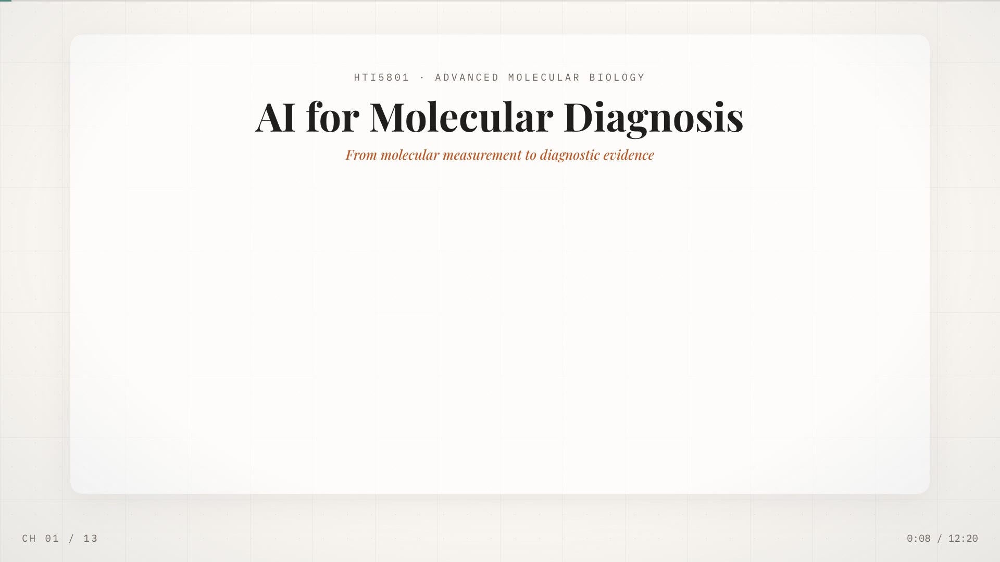
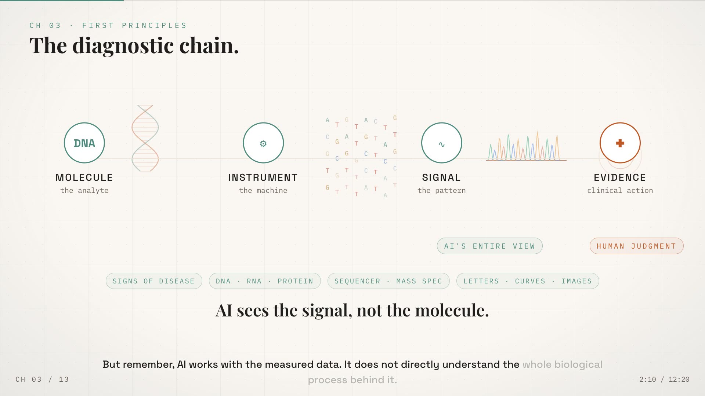
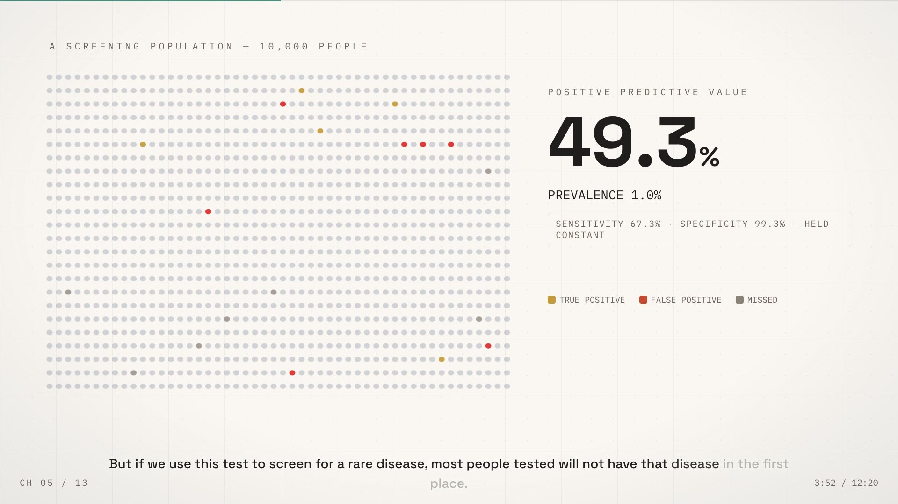
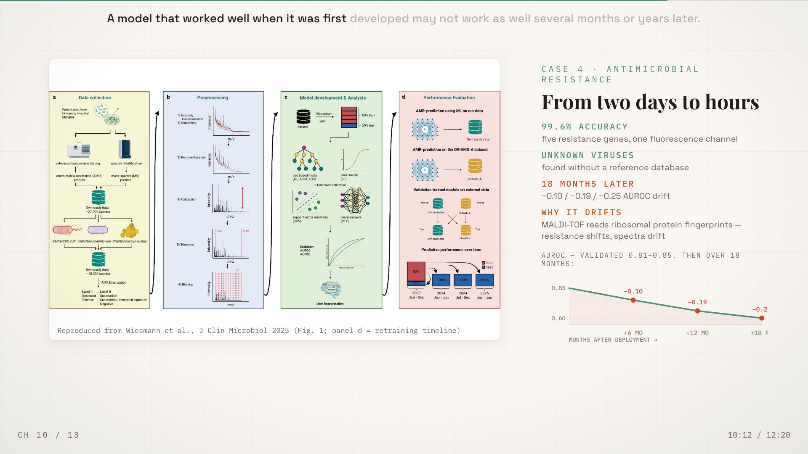
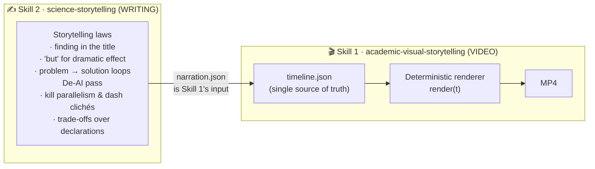
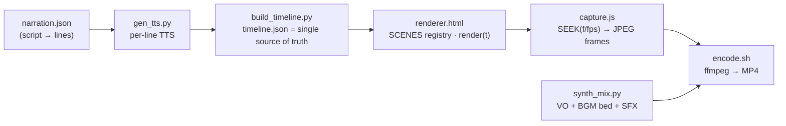

<p align="center">
  <strong>Academic Visual Storytelling</strong><br>
  Turn any narration script into a cinematic explainer video — deterministically, with code.
</p>

<p align="center"><b>English</b> | <a href="README.zh-CN.md">简体中文</a></p>

<p align="center">
  
</p>

# 🎬 Academic Visual Storytelling

A [Claude Code / ZCode **skill**](SKILL.md) + production pipeline that turns a plain
narration script into a **12-minute cinematic explainer video** — built entirely as
code: a deterministic single-file HTML/JS frame renderer, captured headlessly and
assembled with ffmpeg. No After Effects, no timeline dragging, fully re-renderable
from text.

> **Design language**: warm-ivory "Claude editorial" palette, white artifact cards,
> editorial serif headlines (Playfair Display), mono metadata, sculptural 150px
> numbers, and beat-synced motion — *what the narrator names, lights up.*
>
> **Domain-neutral**: ships with palette recipes for biology/medicine, physics/math,
> CS/AI, climate, economics and humanities. Worked example: an 11m45s molecular
> diagnostics lecture film (13 chapters, 5 case studies, 34 reproduced-figure
> seconds, zero hand-drawn assets beyond code).

| | |
|:---:|:---:|
|  |  |
| *Mechanism chain with live instruments* | *Population data engine + sculptural PPV* |
|  |  |
| *Case phase A: concept schematic* | *Static references wall + CRediT dossier* |

---

## ✨ What you get

- **Narration-first pipeline** — you write (or reuse) the narration script; every
  visual beat is keyed to the *measured* duration of each spoken line. Re-time the
  audio and the whole film follows.
- **Deterministic renderer** — one HTML file, `render(t)` is a pure function of
  time; identical frames on every machine. Preview any moment instantly with
  `SEEK(t)` stills before committing to a render.
- **The 3-Phase Case Architecture** — every case study plays as
  *Concept Schematic → Primary Evidence (reproduced paper figure + hero metrics) →
  Critical Boundary (drift curves, ≠ statements)*.
- **Beat-synced micro-interactions** — "read it → light it": the narration names a
  thing, the matching visual ignites. Plus odometers, pen underlines, lens
  magnifiers over real paper figures, signal-wipe chapter transitions.
- **A real caption system** — no white boxes: word-by-word progressive highlight
  (character-proportional timing), domain keywords in the accent color, automatic
  top-placement on dense scenes.
- **Equal-footing credits** — CRediT-style dossier: activity on top, contributor
  below, identical geometry for everyone.
- **Data integrity rules** — every on-screen number must trace to the supplied
  literature corpus or deck; nothing invented.

---

## 🚀 Quickstart

```bash
# 0) dependencies
pip install edge-tts numpy            # narration + audio math
npm install playwright@1.50.0         # headless capture (or npx playwright install chromium)
brew install ffmpeg                   # or apt install ffmpeg

# 1) write your narration (verbatim lines per chapter)
cp templates/narration.template.json narration.json

# 2) synthesize narration per line + build the timeline
python scripts/gen_tts.py             # → audio_lines/*.mp3
python scripts/build_timeline.py      # → timeline.json + master_audio.wav

# 3) author scenes in renderer.html (templates/renderer.template.html shows how),
#    then inject the timeline as the single source of truth
python inject_timeline.py             # → renderer_final.html

# 4) preview any beat WITHOUT rendering (fast!)
npx playwright open renderer_final.html?render=1   # or use SEEK(t) stills

# 5) optional: drop bgm.mp3 next to narration.json and mix
python scripts/synth_mix.py           # → master_mix.wav (VO + bed + SFX)

# 6) render all frames + encode
node scripts/capture.js               # → frames/*.jpg  (~18 min for 12 min @1080p30)
zsh scripts/encode.sh out.mp4         # → final MP4 (faststart)
```

### 🧩 Two skills, one system

This repo ships **two independently installable skills**:



- **Skill 2 (writing)** decides *what to say and how*: the three laws structure the
  narrative; the de-AI pass makes it read like a scientist wrote it. Fully usable
  standalone (papers, reports, talks).
- **Skill 1 (video)** decides *how it's shown*: design system, deterministic
  rendering, capture, audio mastering. It consumes Skill 2's `narration.json`.
- Install both for the full pipeline; install Skill 2 alone as a writing coach.
  A standalone package for Skill 2 lives at [`science-storytelling/`](science-storytelling/).

The skill itself (design + pipeline rules) installs into your agent:

```bash
# Claude Code
git clone https://github.com/<you>/academic-visual-storytelling
cp -r academic-visual-storytelling ~/.claude/skills/
# ZCode
cp -r academic-visual-storytelling <workspace>/.agents/skills/
```

---

## 🧭 How a film is structured



Chapters use five screen archetypes — **Cover film · Route · Mechanism chain ·
Data engine · Case dossier (3 phases) · Close** — each defined in
[SKILL.md](SKILL.md) §3 with beat rules.

### The 3-Phase Case Architecture

Every case study (60–90s) plays as three crossfading phases, gated by narration
lines — never one crowded screen:

| Phase | Content | Example |
|---|---|---|
| **A · Concept schematic** | clean vector animation explaining the mechanism | healthy cfDNA vs flagged tumour cfDNA drifting in a vessel |
| **B · Primary evidence** | reproduced paper figure (cropped, credited, lens-probed) + hero metrics | CCGA study panel · *6,689 participants · spec 99.3%* |
| **C · Critical boundary** | drop-off chart / ≠ statement / warning stamp | *Stage I 39% → IV 92%* · *AUC 0.84 → 0.69 on a new cohort* |

---

## 🎨 The design system (summary)

Warm-ivory canvas `#FAF7F2` · white artifact cards · espresso ink `#1F1E1D` ·
four **semantic accents** you assign once per project:

| Role | Default | Used for |
|---|---|---|
| FOCUS | `#C05621` terracotta | decisions, key claims, the lens, keyword captions |
| SIGNAL | `#4D8B7E` sage | data, mechanisms, the measurement voice |
| RISK | `#C74A2E` | limits, drift, false alarms |
| Gold | `#C49A3B` | ground-truth / positive highlights |

Per-domain recipes (physics, CS/AI, climate, economics, humanities…), the
typography scale, artifact-container rules and the anti-empty-space backdrop
grid are in [SKILL.md](SKILL.md) §2–§3.

### Caption system

No white boxes. Word-by-word progressive highlight (character-proportional
timing), domain keywords in the accent color, automatic **top placement** on
dense scenes, bottom otherwise. The voiceover names a thing — the caption and
the visual light up together.

---

## 📁 Repository layout

```
academic-visual-storytelling/
├─ SKILL.md                    # the skill: design system + production rules
├─ scripts/                    # the pipeline (domain-agnostic)
│  ├─ gen_tts.py               # narration.json → per-line MP3 (edge-tts)
│  ├─ build_timeline.py        # measured durations → timeline.json + VO track
│  ├─ synth_mix.py             # VO + BGM bed + SFX → master_mix.wav
│  ├─ inject_timeline.py       # renderer.html + timeline.json → renderer_final.html
│  ├─ capture.js               # headless Chromium: SEEK(f/fps) → JPEG frames
│  ├─ capture_resume.js        # resume after a long-run crash (frames = checkpoint)
│  └─ encode.sh                # frames + audio → MP4
├─ science-storytelling/
│  └─ SKILL.md                 # companion skill: storytelling laws + de-AI pass
├─ templates/
│  ├─ renderer.template.html   # minimal starter renderer (SCENES + odometer demo)
│  └─ narration.template.json
└─ docs/preview/               # stills from the worked example film
```

---

## 🧪 Lessons that ship with the code

These are documented in [SKILL.md](SKILL.md) §9–§11 because they were each a real
production incident:

- **Crash-resilient capture** — Chromium dies around ~20k screenshots; the frames
  directory is the checkpoint, resume in minutes not hours.
- **Audio-only changes remux in seconds** (`-c:v copy`) — never re-render a film
  for a music tweak.
- **BGM loop tiling** must advance the timeline cursor (a source-cursor loop plays
  the track exactly once — verify with RMS probes).
- **Token migration** must touch JS canvas colors too, not just CSS variables.
- **Verify-before-render**: SEEK(t) stills at every beat catch null refs,
  collisions and overflow for free; a full render costs ~20 minutes.

---

## ❓ FAQ

**Does the narration have to be English?**
One language throughout (VO, captions, on-screen text) — any language edge-tts
supports. Pick it once in `narration.json`.

**Can I use my own voice / music?**
Yes. Record per-line WAVs and point `build_timeline.py` at them; drop `bgm.mp3`
beside `narration.json` (loop + crossfade + level are handled by `synth_mix.py`).

**How long does a render take?**
~18–20 min of capture for a 12-min 1080p30 film on an M-series Mac, +2 min
encode. Audio changes remux in seconds.

**Two skills in this repo** — the film system (`academic-visual-storytelling/`)
and a standalone writing skill (`science-storytelling/`: Kirchoff's
storytelling laws + the de-AI pass) used when authoring `narration.json`.
Install both.

**Is this only for biology?**
No — the worked example is a molecular-diagnostics lecture, but the system is
domain-neutral: swap the palette recipe, the vocabulary, and the figures.

---

## 📄 License

MIT — see [LICENSE](LICENSE). Narration, music and reproduced journal figures
you supply remain your responsibility to cite and license.

<p align="center"><sub>Built in the open from a real course-project production — so your next explainer starts at minute one.</sub></p>
