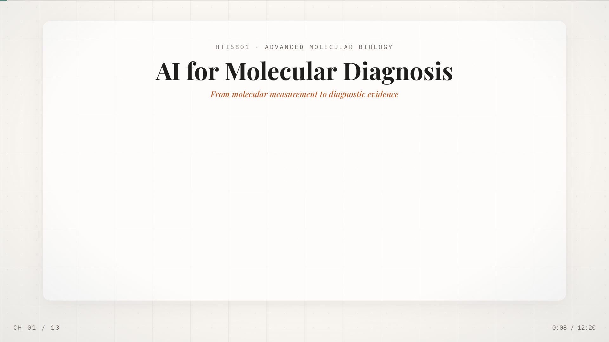
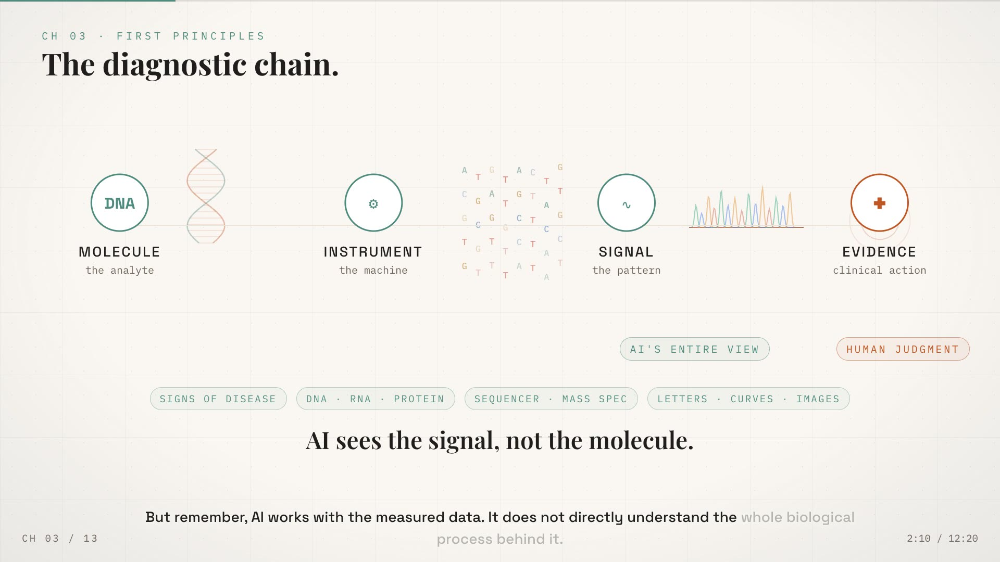
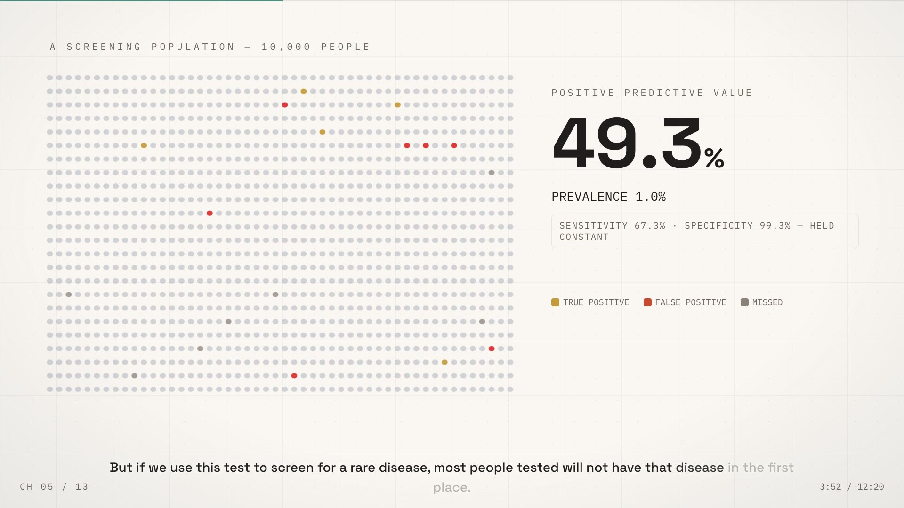
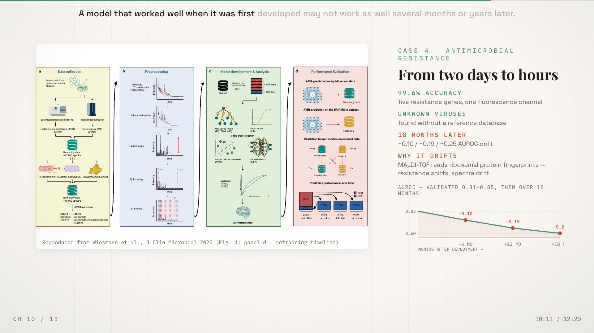
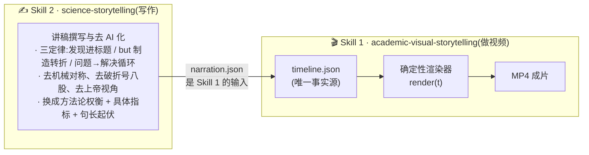
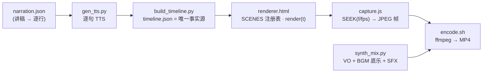

<p align="center">
  <strong>Academic Visual Storytelling</strong><br>
  把任何一份讲稿,变成用代码确定性渲染的电影级科普视频。
</p>

<p align="center">
  <a href="README.md">English</a> | <b>简体中文</b>
</p>

<p align="center">
  
</p>

# 🎬 Academic Visual Storytelling(学术视觉叙事)

这是一个 **Claude Code / ZCode skill** + 完整生产管线:输入一份普通的旁白讲稿,输出一部
**12 分钟的电影级科普讲解视频** —— 全部由代码生成:单文件 HTML/JS 确定性帧渲染器,
无头浏览器逐帧捕获,ffmpeg 合成。不用 After Effects,不拖时间线,改一行文字即可全片重渲。

> **设计语言**:暖沙象牙白的 "Claude 编辑部" 色板、白色 Artifact 圆角卡片、编辑级衬线
> 大标题(Playfair Display)、等宽元数据、150px 雕塑感数字,以及**节拍同步动效** ——
> *旁白念到什么,画面就点亮什么。*
>
> **领域中立**:内置生医、物理数学、CS/AI、气候、经济人文五套配色配方。示例成片:
> 一部 11 分 45 秒的分子诊断课程视频(13 章、5 个案例、复现期刊图、除代码外零手绘素材)。

| | |
|:---:|:---:|
|  |  |
| *机制链条 + 实时示波仪表* | *万人口点阵 + 雕塑感 PPV 大数字* |
|  |  |
| *案例 Phase A:概念示意图* | *静止文献墙 + CRediT 双栏致谢* |

---

## ✨ 你能得到什么

- **旁白优先管线** —— 你写(或复用)讲稿;每个视觉节拍 key 到每句旁白的**实测时长**。
  改音频,全片自动跟随。
- **确定性渲染器** —— 单个 HTML 文件,`render(t)` 是时间的纯函数;任何机器出帧完全一致。
  渲染前可用 `SEEK(t)` 静帧即时预览任意时刻。
- **三阶段案例架构** —— 每个案例按 *概念示意图 → 论文证据(复现图 + 大数字) →
  临床边界(衰减曲线 / ≠ 陈述)* 三幕交叉淡化推进。
- **节拍同步微交互** —— "读到什么点亮什么";外加里程表数字、钢笔下划线、复现论文图的
  放大镜推近、章节信号扫掠转场。
- **真正的字幕系统** —— 没有白底框:逐词渐进点亮(按字符占比计时),领域关键词显示为
  强调色,密集场景自动**置顶**。
- **平等贡献致谢** —— CRediT 风格双栏展板:事项在上、姓名学号在下,所有人卡片几何一致。
- **数据完整性规则** —— 屏幕上每个数字都必须能溯源到所给文献库或 PPT,绝不发明。

---

## 🚀 快速开始

```bash
# 0) 依赖
pip install edge-tts numpy            # 旁白合成 + 音频数学
npm install playwright@1.50.0         # 无头捕获(或 npx playwright install chromium)
brew install ffmpeg                   # 或 apt install ffmpeg

# 1) 写旁白(每章一个场景,每句旁白一行)
cp templates/narration.template.json narration.json

# 2) 逐句合成旁白 + 构建时间轴
python scripts/gen_tts.py             # → audio_lines/*.mp3
python scripts/build_timeline.py      # → timeline.json + master_audio.wav

# 3) 在 renderer.html 中编写场景(templates/renderer.template.html 是入门骨架),
#    然后把时间轴注入为唯一事实源
python inject_timeline.py             # → renderer_final.html

# 4) 不渲染即可预览任意节拍(快!)
npx playwright open renderer_final.html?render=1   # 或用 SEEK(t) 静帧

# 5) 可选:把 bgm.mp3 放在 narration.json 旁并混音
python scripts/synth_mix.py           # → master_mix.wav(VO + BGM 底乐 + 音效)

# 6) 渲染全部帧 + 编码
node scripts/capture.js               # → frames/*.jpg(12 分钟 @1080p30 约 18 分钟)
zsh scripts/encode.sh out.mp4         # → 成品 MP4(faststart)
```

安装 skill 本体到你的 agent:

```bash
git clone https://github.com/<you>/academic-visual-storytelling
# Claude Code
cp -r academic-visual-storytelling ~/.claude/skills/
# ZCode
cp -r academic-visual-storytelling <workspace>/.agents/skills/
```

---

## 🧭 整体架构:两个独立 skill,一个组合拳

本仓库包含**两个可以独立安装、也可以组合使用的 skill**:



- **Skill 2(写作)** 决定"说什么、怎么说":三定律组织叙事,去 AI 化检查清单保证
  文字像人写的。**可完全独立使用**(写论文、写报告、写演讲稿都行)。
- **Skill 1(做视频)** 决定"怎么呈现":设计系统、确定性渲染、捕获、音频母带。
  它消费 Skill 2 产出的 `narration.json`。
- 两者都装 = 全流程;只装 Skill 2 = 纯写作助手。

> 独立版 Skill 2 仓库:[science-storytelling](../science-storytelling/)(本仓库
> `science-storytelling/` 目录内也内置了一份副本)。

---

## 🧭 视频如何组织



章节使用五种屏幕原型 —— **封面影片 · 路线 · 机制链 · 数据引擎 · 案例档案(三阶段) ·
收束** —— 每种的定义与节拍规则见 [SKILL.md](SKILL.md) §3。

### 三阶段案例架构

每个案例(60–90 秒)按旁白行触发,以三个交叉淡化的阶段推进 —— 绝不挤在一个屏幕里:

| 阶段 | 内容 | 示例 |
|---|---|---|
| **A · 概念示意图** | 解释机制的干净矢量动画 | 健康 cfDNA 与带 −CH3 甲基化旗标的肿瘤 cfDNA 在血管中漂流 |
| **B · 论文证据** | 复现期刊图(裁切、带信用行、放大镜推近)+ 大数字 | CCGA 研究面板 · *6,689 名参与者 · 特异度 99.3%* |
| **C · 临床边界** | 跌落图 / ≠ 陈述 / 警示章 | *Stage I 39% → IV 92%* · *新队列 AUC 0.84 → 0.69* |

---

## 🎨 设计系统(摘要)

暖沙画布 `#FAF7F2` · 白色 Artifact 卡 · 浓墨 `#1F1E1D` · 四个**语义强调色**(每项目
指定一次):

| 角色 | 默认值 | 用途 |
|---|---|---|
| FOCUS | `#C05621` 陶土橙 | 决策、关键论断、放大镜、字幕关键词 |
| SIGNAL | `#4D8B7E` 鼠尾草绿 | 数据、机制、"测量/AI"声部 |
| RISK | `#C74A2E` | 局限、漂移、假阳性 |
| Gold | `#C49A3B` | 真阳性 / ground-truth 高亮 |

领域配方(物理、CS/AI、气候、经济、人文)、字号阶梯、Artifact 容器规则与
反空洞背景网格见 [SKILL.md](SKILL.md) §2–§3。

### 字幕系统

没有白底框。逐词渐进点亮(按字符占比计时),领域关键词显示为强调色,密集场景
自动**置顶**。旁白念到一个词 —— 字幕和画面同时点亮。

---

## 📁 仓库结构

```
academic-visual-storytelling/
├─ SKILL.md                    # 技能本体:设计系统 + 生产规则
├─ science-storytelling/
│  └─ SKILL.md                 # 内置副本:写作 + 去 AI 化技能
├─ scripts/                    # 管线脚本(领域无关)
│  ├─ gen_tts.py               # narration.json → 逐句 MP3(edge-tts)
│  ├─ build_timeline.py        # 实测时长 → timeline.json + VO 音轨
│  ├─ synth_mix.py             # VO + BGM 底乐 + SFX → master_mix.wav
│  ├─ inject_timeline.py       # renderer.html + timeline.json → renderer_final.html
│  ├─ capture.js               # 无头 Chromium:SEEK(f/fps) → JPEG 帧
│  ├─ capture_resume.js        # 长任务崩溃后从帧号断点续渲
│  └─ encode.sh                # 帧 + 音频 → MP4
├─ templates/
│  ├─ renderer.template.html   # 极简启动渲染器(SCENES + odometer 示例)
│  └─ narration.template.json
└─ docs/preview/               # 示例成片截帧
```

---

## 🧪 随代码一起交付的实战经验

每一条都写在 [SKILL.md](SKILL.md) §9–§11,因为它们都是真实发生过的事故:

- **崩溃可续的捕获** — Chromium 在 ~2 万张截图时会内存崩溃;帧目录即检查点,
  续渲只需几分钟而非重来。
- **纯音频改动秒级 remux**(`-c:v copy`)—— 改音乐永远不要重渲染画面。
- **BGM 循环平铺**必须推进时间轴游标(游标写错的循环会把曲子只放一遍 —— 用
  RMS 探针验证)。
- **Token 迁移**要同时改 JS 画布里的裸色值,只换 CSS 变量会留下旧配色。
- **渲染前先验证**:SEEK(t) 静帧能免费抓出空引用、碰撞和出界;全渲染要 20 分钟。

---

## ❓ FAQ

**本仓库有两个 skill** —— 影片系统(`academic-visual-storytelling/`)和独立的写作
技能(`science-storytelling/`:Kirchoff 叙事三定律 + 去 AI 化检查),后者在
撰写 `narration.json` 时使用。两个都装,或按需单装。

**旁白必须是英文吗?**
全片统一一种语言(VO、字幕、画面文字)—— edge-tts 支持的语言都可以,在
`narration.json` 里一次选定。

**能用真人配音 / 自己的音乐吗?**
可以。按行录制 WAV 交给 `build_timeline.py`;把 `bgm.mp3` 放在 `narration.json`
旁边(循环、交叉淡化、音量由 `synth_mix.py` 处理)。

**渲染要多久?**
12 分钟 1080p30 的成片,M 系列芯片上捕获约 18–20 分钟 + 编码 2 分钟。音频改动
秒级 remux。

**只适用于生物吗?**
不 —— 示例成片是分子诊断课程,但系统领域中立:换配色配方、词汇和图片即可。

---

## 📄 License

MIT — 见 [LICENSE](LICENSE)。你提供的旁白、音乐与复现期刊图,引用与授权由使用者
自行负责。

<p align="center"><sub>来自一个真实课程项目的生产技能 —— 让你的下一部科普视频从第一分钟就站在完整管线上。</sub></p>
